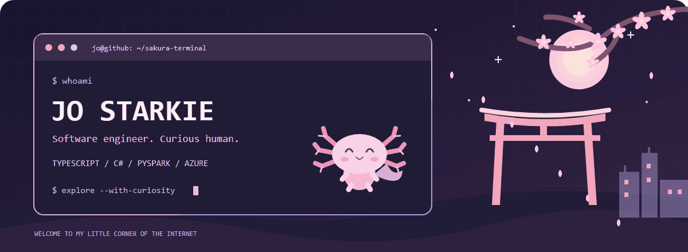
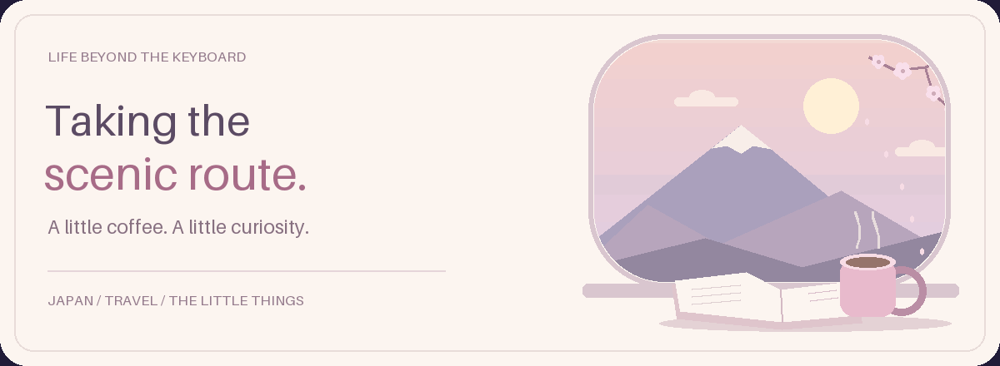

<div align="center">

<picture>
  <source media="(prefers-reduced-motion: reduce)" srcset="./assets/axolotl-sakura-terminal-still.png">
  
</picture>

# こんにちは、I'm Jo 🌸

**Software Engineer II @ Microsoft · She/Her**

**TypeScript · C# · JavaScript · PySpark · Azure · API & SDK Development**

Building Dynamics 365 Contact Center experiences, developer-facing SDKs, and reliable cloud services. Former Cloud Solution Architect. Always curious; currently learning Japanese.

[🌐 Website](https://thestarkie.com) · [💼 LinkedIn](https://www.linkedin.com/in/jostarkie/) · [📄 Request my CV](https://thestarkie.com/#/cv) · [🏅 Certifications](https://www.credly.com/users/jo-starkie/badges)

**[Meet the developer](#-character-select) · [Explore my engineering](#-engineering-quest-log) · [Visit the workshop](#-the-workshop)
· [Try a side quest](#-side-quest-the-flip-flop-café)**

</div>


> 🕹️ **Welcome, player two.** Pick a quest below: explore the engineering, open the inventory, or grab a coffee and solve the café puzzle. No installation. No boss fight. Probably.

## 🎮 Character select

```javascript
const jo = {
    role: "Software Engineer II",
    workplace: "Microsoft",
    building: "Dynamics 365 Contact Center",
    toolkit: ["TypeScript", "C#", "PySpark", "Azure"],
    background: ["Cloud Solution Architecture", "Software Engineering"],
    interests: ["building software", "Japan", "travel"],
    learning: ["Japanese", "roller skating"],
    unexpectedSkill: "Actually enjoying flatpack furniture",
    openTo: ["collaboration", "career chats", "virtual coffee"]
};
```

<details>
<summary><strong>🌸 Open the character card</strong></summary>

Hey, I'm Jo! I like making things work, understanding why they work, and finding people to build with.

My work spans customer-facing product features, public API design, SDK development, C# backend services, and data engineering. Before moving into software engineering, I helped customers design Azure data and analytics solutions as a Cloud Solution Architect.

Japan is a big love of mine, and I'm learning to read and speak Japanese. Away from the keyboard, I'm unusually enthusiastic about building flatpack furniture. Apparently, following instructions and debugging missing pieces is a cross-platform hobby.

I'm also learning to roller disco and slowly but surely working through my travel bucket list. A few more adventures, a few fewer wobbles. 🛼 🌏

I also mentor early-career Cloud Solution Architects and aspiring Software Engineers, co-founded UnlockHerTech, and take part in STEM outreach. I graduated from Brunel with First Class Honours in Computer Science (Artificial Intelligence).

Ask me about personal and career development, an application you're working on, or your latest flatpack achievement.

</details>

<details>
<summary><strong>🧰 Open the inventory</strong></summary>

| Inventory slot | Languages & tools |
| --- | --- |
| Product & backend engineering | C# · TypeScript · JavaScript · Node.js · React |
| Data engineering | PySpark · SQL · Azure Data Factory · Microsoft Fabric |
| Cloud & platforms | Azure · Azure Functions · AKS · Dynamics 365 · Dataverse · Power Platform · Microsoft Purview |
| APIs & SDKs | API design · SDK development · TypeSpec · OpenAPI |
| Automation & delivery | PowerShell · Bicep · CI/CD · Azure DevOps |
| Quality & reliability | Automated testing · Observability · Production debugging · Event-driven systems |
| Everyday kit | VS Code · Git · GitHub |
| Earlier explorations | Java · Android · Jupyter Notebooks · R · HTML · CSS |

An inventory, not a leaderboard: different projects call for different tools.

</details>

<details>
<summary><strong>🛼 Enter after-hours mode</strong></summary>

| Side quest | Current save file |
| --- | --- |
| 🛼 Roller disco | Learning. Slowly replacing the wobble with the groove. |
| 🌸 Japanese | Learning to read and speak; enjoying the journey. |
| 🌏 Travel | Working through my bucket list, one adventure at a time. |
| 🪛 Flatpack furniture | The rare side quest where I actively want the assembly instructions. |
| ☕ Co-op mode | Always happy to talk projects, careers, and virtual coffee. |

**Achievement unlocked:** you found the person behind the pull requests.

</details>

## ⚙️ Engineering quest log

The day-job side of the story: product engineering with a cloud-and-data background. Expand a chapter to explore.

<details>
<summary><strong>🎧 Contact Center: TypeScript, SDKs & real-time experiences</strong></summary>

I build features for Dynamics 365 Contact Center across voice, messaging, and the Headless Customer Service Representative SDK.

- **APIs developers build on:** conversation, presence, disposition-code, and administration capabilities, with consistent types and pagination.
- **Rich messaging:** Adaptive Cards and rich-content support so representative applications can send, retrieve, and respond to more than plain text.
- **Reliability:** investigating calling, recording, transcription, and integration problems using telemetry, code tracing, and reproduction environments.
- **Developer experience:** sample applications, automated tests, tooling, and documentation that help people actually use the SDK.

The interesting part isn't just making a feature work once. It's making its public contract predictable, its failures understandable, and its behaviour reliable.

</details>

<details>
<summary><strong>🛠️ Retail & data platforms: C#, PySpark & Azure</strong></summary>

Before Contact Center, I worked across Dynamics 365 and Microsoft's retail products.

- **C# services:** backend retail-data processing, event handling, duplicate-processing prevention, refactoring, and automated tests.
- **Data integration:** helping take the ISV Data Connector for Smart Store Analytics from private preview to general availability, including Azure Data Factory pipelines, validation, and deployment.
- **PySpark:** building and demonstrating a Retail Data Manager connector in a two-person engineering team, delivering the prototype in six weeks for NRF.
- **Platform engineering:** partner APIs, TypeSpec/OpenAPI definitions, deployment tooling, and configuration for services running in Azure Kubernetes Service.
- **Prototyping:** exploring AI-powered shopping integrations and bringing Microsoft 365 content into retail catalogue experiences.

C# and PySpark are part of my hands-on engineering experience, not just items on a tools list.

</details>

<details>
<summary><strong>☁️ Cloud architecture: data, automation & sharing knowledge</strong></summary>

As a Cloud Solution Architect, I worked with customers on Azure data and analytics architecture, particularly data warehousing and Microsoft Purview.

I built PowerShell and Bicep automation, examples, and hands-on labs to make Purview easier to deploy and learn. I also delivered technical training on Azure Databricks, Git, and CI/CD, and helped run Power BI workshops.

That customer-facing background still shapes my engineering: think about the person consuming the API, deploying the service, or trying to understand what went wrong.

</details>


## 🏮 The workshop

A few doors into my public projects. Pick one and have a look around.

| Door | What's inside |
| --- | --- |
| [☁️ Purview Accelerator](https://github.com/JWStarkie/PurviewAccelerator) | PowerShell automation for deploying and exploring Microsoft Purview. |
| [🍡 Madam Wasabe Bestie](https://github.com/JWStarkie/Madam_Wasabe_Bestie) | A playful experiment with an ElevenLabs agent. |
| [🚗 LearnMYCar](https://github.com/JWStarkie/LearnMYCarApplication) | My university project exploring mobile development, machine learning, and augmented reality. |
| [🌐 My website](https://github.com/JWStarkie/JWStarkie.github.io) | The repository behind my personal website. |
| [🗺️ Explore all public repositories](https://github.com/JWStarkie?tab=repositories) | More experiments, learning projects, and technical rabbit holes. |

## 🍵 Side quest: the flip-flop café

Your order is an array: **`[-4, -2, 3]`**.

You must flip a number's sign **exactly three times**. You can choose the same number more than once.

**What's the largest final sum you can serve?** Think it through, then open the panels below.

<details>
<summary><strong>💡 Ask the barista for a hint</strong></summary>

Turn the most negative numbers positive first. Each flip gives you a bigger increase than flipping a number closer to zero.

Once everything is non-negative, extra flips cancel in pairs. If one flip is left over, make it as inexpensive as possible.

</details>

<details>
<summary><strong>✨ Reveal the order</strong></summary>

```text
Start:          [-4, -2, 3]
Flip -4:        [ 4, -2, 3]
Flip -2:        [ 4,  2, 3]
Flip  2:        [ 4, -2, 3]

Final sum: 4 - 2 + 3 = 5
```

Why flip `2` last? It causes the smallest loss.

Changing `+2` to `-2` loses **4**, not 2: you remove the positive contribution and replace it with a negative one.

Tiny takeaway: changing `+x` to `-x` decreases the total by **`2 * x`**.

</details>

<details>
<summary><strong>🐈 Unlock the bonus question</strong></summary>

**What if you had four flips instead of three?**

The answer is **9**. Flip both negatives, then spend the remaining two flips on the same number:

```text
[-4, -2, 3] → [4, -2, 3] → [4, 2, 3] → [4, -2, 3] → [4, 2, 3]
```

Exactly four flips. The last two cancel. The café approves.

</details>


## ☕ Pull up a chair

<div align="center">

Got an interesting project, a career question, or a strong opinion about flatpack furniture?

**[Let's connect on LinkedIn](https://www.linkedin.com/in/jostarkie/)** · [Visit my corner of the web](https://thestarkie.com)

<picture>
  <source media="(prefers-reduced-motion: reduce)" srcset="./assets/scenic-route-still.png">
  
</picture>

*Built with curiosity. Decorated with sakura.* 🌸

</div>
